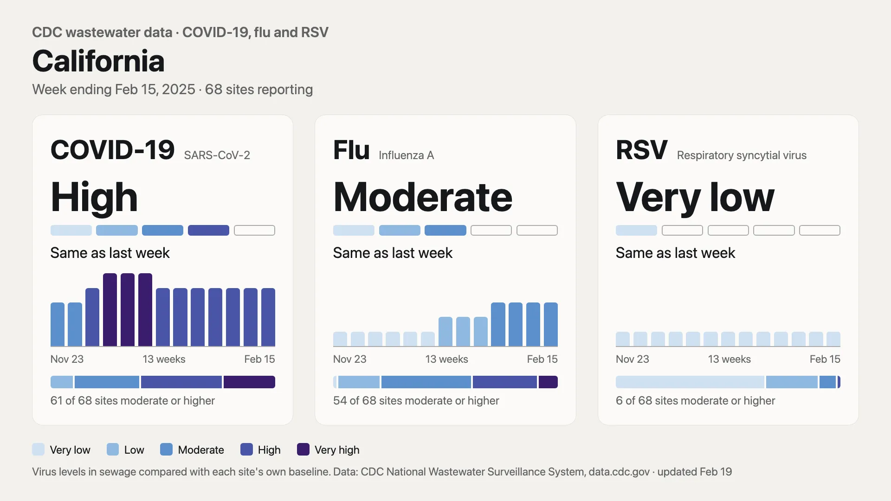

[](https://github.com/Screenly/cdc-wastewater-app/releases/latest)

# CDC Wastewater: Screenly Edge App



COVID-19, flu and RSV levels in wastewater for the United States, a state, a
county or a single treatment site, from the CDC's
[National Wastewater Surveillance System](https://www.cdc.gov/nwss/). Each
virus gets a card with its level (Very low, Low, Moderate, High or Very high),
a five-step meter, how it changed since last week, a bar for each of the last
13 weeks, and how the reporting sites split across the levels. Nothing
animates. CDC publishes once a week, on Fridays, and the screen checks every
hour.

Wastewater levels describe how much virus is in sewage compared with each
site's own baseline. They are not case counts.

## Settings

| Setting             | Default | Advanced | Description                                                                                    |
| ------------------- | ------- | -------- | ---------------------------------------------------------------------------------------------- |
| `state`             | blank   | No       | US state or territory, by name or code (`California` or `CA`). Blank covers the whole country. |
| `county`            | blank   | No       | One county within the state, such as `Los Angeles`. Needs a state.                             |
| `theme_mode`        | `light` | No       | `light` or `dark`.                                                                             |
| `site_id`           | blank   | Yes      | One treatment site by its CDC ID, such as `112`. Overrides `state` and `county`.               |
| `skip_when_no_data` | `false` | Yes      | Skip the app when the area has no recent reports. Needs ScreenlyOS 26.9 or later.              |
| `show_cached_data`  | `true`  | Yes      | Keep showing the last data while CDC cannot be reached.                                        |
| `when_unreachable`  | `skip`  | Yes      | `skip` or `message` when CDC cannot be reached and nothing is cached.                          |
| `override_locale`   | `en`    | Yes      | Locale for numbers and dates, such as `fr` or `pt-BR`. Labels stay in English.                 |
| `display_errors`    | `false` | Yes      | Show errors on screen. For debugging only.                                                     |
| `sentry_dsn`        | blank   | No       | Sentry client key for error reporting.                                                         |

## Data

The data is
[CDC Wastewater Viral Activity Level for SARS-CoV-2, Influenza A and RSV](https://data.cdc.gov/resource/atcp-73re.json)
on data.cdc.gov, a public Socrata dataset. It needs no key, allows commercial
use and sends `Access-Control-Allow-Origin: *`, so the app calls it directly.
Socrata throttles unauthenticated requests per IP address, which an hourly
refresh stays far below.

The dataset only has site-level rows: one per sewershed, virus and week, each
with CDC's category for that site. CDC sets the category thresholds per virus,
and the raw values run into the millions at a few sites. So the app does not
average the values or apply thresholds of its own. It asks Socrata to count,
for each week and virus, how many sites in scope fell in each category, which
is about 200 rows for the whole country. The level shown is the category of
the median site. With an even number of sites it takes the lower of the two
middle ones, so it never rounds a level up. CDC's own state figures on its
data tracker may be worked out differently, so the two can disagree by a
level.

The latest week is often missing sites that report late, and the heading
says how many sites reported. A site that stopped reporting drops out of the
counts. A week with no reports for a virus shows as a gap in its bars, and a
virus with no report this week says so. When the latest week is more than
three weeks old, the heading says "Latest report" instead of "Week".

Influenza here is influenza A only. That is what the dataset covers.

## Behaviour when the API fails

This follows the Edge Apps failure-mode algorithm. A setting that cannot work
(a county with no state, or a sewershed ID that is not a number) is caught
before any request, and the screen says what to fix.

| API                | `display_errors` | Result                                                |
| ------------------ | ---------------- | ----------------------------------------------------- |
| OK                 | —                | Cache the data, show it                               |
| OK, never had rows | —                | Say "No sites found"                                  |
| OK, no recent rows | —                | Skip if `skip_when_no_data`, else say so              |
| Failed             | on               | Show the error, draw nothing                          |
| Failed             | off              | Cached and `show_cached_data`: show it, with its week |
| Failed             | off              | Otherwise: `when_unreachable` skips or says so        |

The last row is the diagram's **Abort** terminal. By default the app calls
`screenly.signalAbort()` and the player moves on to the next item, recording
the skip as neither a play nor a failure. Where `signalAbort()` does not exist,
the app says what happened and signals ready anyway, as an app that never
signals stalls the playlist for sixty seconds. The app only asks to be skipped
on its first load. A refresh that comes back empty an hour later shows the
message instead of pulling a screen that is already playing.

An empty answer leads to one more request, with no date limit, to tell an area
that went quiet from one CDC has never had a site for.

The cache remembers the area it was fetched for and is ignored if the settings
have changed since.

Each request is given 8 seconds. The screenshotter allows 10 seconds for the
page to go quiet and 10 more for the ready signal, so timing out early leaves
room to fall back to the cache, draw and signal.

## Layout

On a landscape screen the three viruses sit side by side. On a portrait screen
they stack, and each card puts its level beside its history. Every size is a
multiple of one unit, a hundredth of the screen's width or of its height scaled
to 16:9, so the layout fills any shape.

The five levels use one hue, ordered by lightness, so the order reads without
colour vision, and every level is also written out in words. In the light
theme the colour darkens as the level rises. In the dark theme it brightens, so
Very high stays the most visible on a dark card. A legend
at the bottom names the colours. The library's stylesheet is not imported, as
its embedded Inter faces are 444 KB and this app uses `system-ui`.

## Development

```bash
bun install
bun run dev
```

Mock screen data is in `mock-data.yml`. Add `state`, `county` or `site_id`
under `settings` to try an area.

```bash
bun run type-check   # also runs automatically before every build
bun run lint
bun run format
bun run test         # unit tests for the query, the median and parsing
bun run screenshots  # Playwright captures at each signage resolution
```

## Screenshots

`bun run screenshots` writes WebP files into `screenshots/`. California, the
default, covers every supported player resolution as
`california-{width}x{height}.webp`. Texas and New York (dark theme) are shot at
1920x1080 and 1080x1920 only. The CDC answers are fixtures in `e2e/fixtures/`:
real data moved back in whole weeks so the latest week ends just before the
library's fixed screenshot clock.

## Deployment

First time:

```bash
screenly edge-app create --name cdc-wastewater-app --in-place
bun run deploy
screenly edge-app instance create
```

Or run the **Initialize Edge App** GitHub Action for stage and production, then
set `STAGE_EDGE_APP_ID` / `PRODUCTION_EDGE_APP_ID`. Both need the
`SCREENLY_API_TOKEN` secret. After that, deploys go through **Update Edge App**,
which calls the reusable workflows in
[Screenly/edge-apps-actions](https://github.com/Screenly/edge-apps-actions).

## License

MIT. The data is published by the CDC and is in the public domain.
